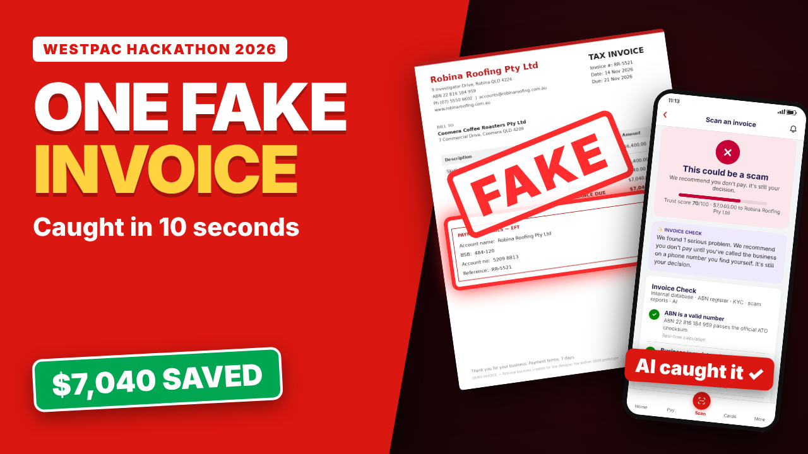

# Invoice Checker: check the bill before the money moves

**Westpac Innovation & Coding Competition 2026.** Scammers send real-looking invoices with their own bank account swapped in. Invoice Checker scans the invoice with Gemini AI and runs its safety checks (ABN register, who really owns the bank account (KYC), scam reports, PDF editing, QR codes, payment history and more) *before* any money moves. The answer is a simple traffic light: 🟢 pay, 🟡 call the business first, 🔴 don't pay.

## 🎬 Watch the video

[](https://youtu.be/6NL0rz2xUsU)

**https://youtu.be/6NL0rz2xUsU**: Cate's story (one phishing click, one fake invoice) and a live demo of the app.

## 🌐 Try the live app

**https://invoice-checker-v2.onrender.com**

No install and no API key needed: Gemini AI is already connected on the server. It's on a free host that sleeps when nobody's using it, so the first visit can take about a minute to wake up.

## 📱 How to use the app

1. Open the app and tap **Scan invoice** (the red button at the bottom, or the shortcut on the home screen).
2. **Upload** an invoice image or PDF, take a **photo**, or paste an **email**.
3. Gemini reads the invoice and fills in the payment for you: business, ABN, BSB, account, amount, GST and contact details. Check they match the invoice.
4. Tap **Check this invoice**. The checks tick off one by one: the ABN, the business register, GST registration, who owns the bank account (KYC), the PayID and QR code, payment history, money-mule signals, scam reports, signs of editing (including inside the PDF file), duplicates, how this invoice compares with the supplier's past ones, the amount and the payment pattern, plus an AI risk review.
5. Read the result:
   - 🟢 **Everything checks out**: tap *Pay this invoice*.
   - 🟡 **Check before you pay**: the app shows the business's number from the business register (never the one on the invoice). Call them, then tap *They confirmed it* (turns 🟢) or *They didn't send it* (opens a fraud case).
   - 🔴 **This could be a scam**: the app recommends *Don't pay this invoice*. It never blocks you; the choice stays yours.
6. For large payments to new payees, the app asks three quick scam questions before the payment goes through.

The **Backend** panel next to the phone shows every live API call, the database, whether Gemini is connected, today's AI usage, and lets you change Alex's account balances.

## ✨ What else it does

| Feature | What happens |
|---|---|
| 📄 **Edited-PDF detection** | Looks inside the PDF file itself (no AI): which program made it, whether it was later saved in a PDF editor, and when it was changed. Catches invoices edited to swap the bank details (try **T15**). |
| 🔳 **QR codes and PayID** | Reads QR codes on invoices and checks who the PayID really belongs to. Flags a QR code that pays somewhere other than the printed details (try **T17**). Invoices with only a PayID can be paid by PayID (try **T16**). |
| 🔁 **Duplicate invoices** | Paid invoices are remembered. Scanning one again warns *"You've already paid this invoice"*. |
| 📈 **Supplier history** | Compares the invoice with what you've paid this supplier before: unusually big amounts, more invoices than usual, or new bank details. |
| 📞 **Call the business** | For 🟡 and 🔴 results: their registered phone number, plus buttons to record what they said. |
| 📧 **Forward by email** | Once an inbox is set up (see *Optional services* below), forward an invoice email to the app's Gmail address. It's checked automatically, you get the result by email, and it appears under **Scan → Forwarded by email**. |
| 🛡️ **Usage limits** | Each visitor can scan 30 invoices an hour, and the app makes at most 500 AI calls a day, so a public link can't use up the Gemini quota. |
| 💾 **Database that survives restarts** | With a free Upstash database connected, everything added in the staff console and every payment is kept when Render restarts the app. |

## 🧪 Test invoices: check it yourself

The [`test-invoices`](test-invoices) folder has **17 ready-made invoices**: genuine bills and scams. Download any of them, upload it with **Scan invoice**, and compare the result with this table. All the businesses are fictional, and every invoice is billed to the demo business Coomera Coffee Roasters.

| File | What it tests | Result in the app |
|---|---|---|
| T01_robina_roofing_genuine.png | Genuine supplier, KYC-verified account | 🟢 Green |
| T02_southport_furniture_small.png | Genuine small payment ($3,850) | 🟢 Green |
| T03_ormeau_tiling_genuine.png | Genuine, matches the register | 🟢 Green |
| T04_tweed_landscaping_nsw.png | Genuine interstate (NSW) business | 🟢 Green |
| T05_helensvale_electrical_sole_trader.png | Sole trader, personal-name account linked to the ABN | 🟢 Green |
| **T06_robina_roofing_wrong_account.png** | **Cate's fake invoice:** real business, but the bank account belongs to another business | 🔴 Red |
| T07_labrador_car_rentals_cancelled_abn.png | Cancelled ABN | 🔴 Red |
| T08_burleigh_conveyancing_settlement_scam.png | $48,500 property-settlement scam: look-alike email, reported mule account, "pay today" | 🔴 Red |
| T09_ormeau_tiling_gmail_amber.png | Real business, but sent from Gmail with a different phone number | 🟡 Amber |
| T10_unknown_business_valid_abn.png | Valid ABN, but the business and account are unknown to the bank | 🔴 Red |
| T11_name_does_not_match_abn.png | Business name doesn't match the ABN | 🔴 Red |
| T12_invalid_abn_typo.png | ABN wrong by one digit | 🔴 Red |
| T13_wrong_gst_maths.png | GST doesn't add up | 🔴 Red |
| T14_robina_roofing_genuine.pdf | Same as T01, as a PDF | 🟢 Green |
| T15_robina_roofing_edited_pdf.pdf | Real invoice edited in a PDF editor to change the bank details | 🔴 Red |
| T16_ormeau_tiling_payid_qr.png | Genuine invoice paid by PayID, with a matching QR code | 🟢 Green |
| T17_robina_roofing_qr_swapped.png | Genuine details, but the QR code pays a scammer's PayID | 🔴 Red |

**Try Cate's story yourself:** upload **T06** (fake, 🔴), then **T01** (the genuine invoice from the same business, 🟢).

The test invoices also work without a Gemini key, and when Gemini is busy: what the AI read from each one is saved in `data/test-invoices.json`. After you pay one, scanning it again warns that it's already paid; *Reset to sample data* in the staff console starts fresh.

The AI risk review can occasionally add an extra warning, so a result may be one step stricter than the table. More detail on each invoice is in [`test-invoices/EXPECTED-RESULTS.md`](test-invoices/EXPECTED-RESULTS.md).

## ⚙️ Optional services (set on Render under Environment, or in `.env`)

| Setting | What it's for | How to get it |
|---|---|---|
| `GEMINI_DAILY_LIMIT`, `SCANS_PER_HOUR` | Usage limits (default 500 AI calls a day, 30 scans per visitor an hour) | Just set the numbers |
| `UPSTASH_REDIS_REST_URL`, `UPSTASH_REDIS_REST_TOKEN` | Keep the database when Render restarts the app | Free at https://upstash.com → *Create database* → copy the two **REST** values |
| `EMAIL_USER`, `EMAIL_APP_PASSWORD` | The Gmail inbox people forward invoices to | Make a new Gmail account for the app, turn on 2-Step Verification, then create an app password at https://myaccount.google.com/apppasswords |
| `BREVO_API_KEY` | Sends the reply emails. Render's free plan blocks normal email sending (SMTP), so replies go through Brevo's API | Free at https://www.brevo.com → *SMTP & API* → *API keys*. Add the Gmail address as a verified sender |

All of these are optional: without them the app works as before. The Backend panel shows which ones are on.

## 💻 Run it on your own computer

You need [Node.js](https://nodejs.org) 18 or newer.

```bash
npm install
npm start
```

Open http://localhost:3000 (Windows: double-click `start.bat`). To read your own invoices with AI, add a free Gemini key from https://aistudio.google.com/apikey at http://localhost:3000/staff.html#settings, or in a `.env` file (copy `.env.example`). Without a key, only the built-in demo invoices in `public/` are read automatically; for others, type the details in.

---

# Developer notes

## Invoice Checker V2

V2 combines the two versions of the project:

- **Frontend:** the phone banking app from the `UI-Version` branch (`public/index.html` + `public/apis.js`): Scam Protect, the invoice scanner (Upload / Email / Photo), name checks, the Scam Risk Score, the big payment plan, the message checker and scan history.
- **Backend:** this Invoice Check server: Gemini reads invoices, the 9 checks run against the bank database (`data/bank.sqlite`), and you can use the staff console and settings.

| Page | What it is |
|---|---|
| http://localhost:3000 | The phone app (UI-Version design, Invoice Check backend) |
| http://localhost:3000/classic.html | The original Invoice Check business app |
| http://localhost:3000/staff.html | Staff console: browse and edit the bank database, API keys |

Run it the same way as before: `npm install` (once), then `npm start` (or double-click `start.bat`).

**How the parts connect**
- `lib/app-api.js` provides the routes the phone app calls (`/api/health`, `/api/invoice/read`, `/api/invoice/analyze`, `/api/payment/*`, `/api/message/check`, `/api/plan/start`, `/api/intel/report`, `/api/customer/me`, `/api/bpay/:code`). Each one uses the Invoice Check backend:
  - **Reading an invoice** uses Gemini (`lib/gemini.js`). Without a key, it uses the saved details for the demo invoices.
  - **Scanning an invoice** happens in two steps, using the Invoice Check app's AI animations:
    1. **Scan and fill in:** an "AI is reading your invoice" screen with a scan line over the invoice. Then every field is filled in one by one: business, ABN, bank details, amount, reference, invoice number, date, subtotal, GST, total, email and phone.
    2. **Check:** the customer checks the details and taps **Check this invoice**. `lib/checks.js` then checks them against the internal database, the ABN register and KYC records, one check at a time. The result card shows the trust score and the "✨ INVOICE CHECK" summary. An AI risk review is added when Gemini is on.

    Editing a field after the check re-checks straight away.
- **Backend panel** (next to the phone; on small screens, tap the **Backend** button):
  - whether the Gemini key is set, the model, ABN Lookup mode and a **Test Gemini key** button
  - row counts for each database table, with links to browse it or add a business, bank account, scam report or PayID in the staff console
  - a live log of every API call the phone app makes. Tap one to see what was sent and received.
  - **Name check and Scam Risk Score** use the `bank_accounts` and `scam_reports` tables.
- `lib/app-data.js` adds the phone app's demo data to the same database: Sam Lee, Jordan Smith, Bright Spark Electrical, K Nguyen and the other demo accounts, plus the PayIDs, BPAY billers and Alex Chen's identity (KYC) profile. Rows are only added if they're missing, and *Reset to sample data* adds them back.
- "Report as scam" in the phone app saves the report and opens a case in the staff console (`fraud_cases`).
- The phone app keeps its own rule: **inform, never block**. A red result recommends "Don't pay", but the customer can still continue. The classic app still blocks red payments on the server.

**Demo invoices for the phone app:** `public/sample-invoice-genuine.txt` / `-scam.txt` (paste into Email, or drag in), `sample-invoice.png` / `.pdf` (green), `sample-invoice-edited.pdf` (red). The Gold Coast Motors images in `public/samples/` work in the phone app's scanner too.

The UI branch's full feature guide is in `docs/UI-HOW_IT_WORKS.md`. Its server, PDF.js and Tesseract parts aren't used in V2, because Gemini does the reading.

## Put it online (so nobody needs their own Gemini key)

The Gemini key is **never** committed to this repo, because the repo is public and anyone could take the key. Instead, the app runs on a free host with the key stored in the host's settings, and people just open the link.

**Render (free):**
1. Sign in at https://render.com with GitHub → **New** → **Web Service**.
2. Choose this repo (or paste its URL under *Public Git repository*) and pick the **`invoice-check`** branch.
3. Settings: Runtime **Node**, Build command `npm install`, Start command `npm start`, Instance type **Free**.
4. Under **Environment Variables** add `GEMINI_API_KEY` = your key (and optionally `ABR_GUID`, `GEMINI_MODEL`).
5. Click **Create Web Service**. After a few minutes you get a link like `https://invoice-checker-v2.onrender.com`. Share that link.

If your Render account can see the repo, **New → Blueprint** uses `render.yaml` and only asks you for the key.

Good to know:
- The free plan sleeps after 15 minutes without visitors; the first visit after that takes about a minute to wake up. Open the link a minute before a demo.
- The database resets to the sample data whenever Render restarts the app. Anything added in the staff console is temporary.
- The key can't be seen or changed from the website: the settings page only shows it masked, and saving settings only works on the computer running the app.
- Anyone with the link can scan invoices using your Gemini quota. In Google Cloud Console you can restrict the key to the Gemini API and set a daily quota.

---

# Invoice Check: Westpac Hackathon 2026 prototype

An AI feature inside a Westpac-style banking app. Before a large transfer, the customer scans the invoice. AI reads it, then we verify the ABN, the business register, who really owns the bank account (Confirmation of Payee), payment history, money-mule signals and signs of tampering. The result is 🟢 / 🟡 / 🔴 with a plain-English explanation.

## 1. Run it (5 minutes)

You need **Node.js 18 or newer** (https://nodejs.org, LTS version).

```bash
cd invoice-check
npm install
npm start
```

Open **http://localhost:3000**. It works straight away in demo mode, with no keys needed for the 4 demo invoices.

Windows shortcut: double-click `start.bat`. Mac/Linux: `./start.sh`.

**API keys:** easiest is http://localhost:3000/staff.html#settings, where you paste the keys and click Save (also sets the large-payment threshold). Or edit the `.env` file.

## 2. Add your API keys (where they go)

Keys go in a file called **`.env`** in the project folder. They stay on the server and are never sent to the browser.

1. Copy `.env.example` and rename the copy to `.env`
2. Open `.env` in any text editor and paste your keys after the `=`:

```
GEMINI_API_KEY=AIza...your key...
GEMINI_MODEL=gemini-3.8-flash
ABR_GUID=your-guid-here
```

3. Save, stop the server (Ctrl+C) and run `npm start` again.
4. The terminal and the page's side panel show **AI: Live** when it's working.

### Where to get the keys
| Key | What it does | Get it |
|---|---|---|
| `GEMINI_API_KEY` | Reads any uploaded invoice (vision AI) and writes the explanation | Free: https://aistudio.google.com/apikey → *Create API key* |
| `ABR_GUID` (optional) | **Live** ABN lookups against the real Australian Business Register | Free: https://abr.business.gov.au/Tools/WebServices → register; the GUID is emailed |

If a model name stops working, change `GEMINI_MODEL` (for example to a newer "flash" model listed in AI Studio).

## 3. How the app works (business-to-business)
The customer is a business (**Coomera Coffee Roasters Pty Ltd**) paying its suppliers from the Westpac Business app.

1. **Pay a business** → choose an unpaid **bill** (invoice inbox), a **saved business**, or **Pay a new business**
2. Choose how to add the details: **scan invoice**, **upload invoice** or **enter manually**. As soon as an ABN is entered, the app shows whether it's a saved business, a new business found on the register, or invalid/cancelled
3. **Under the threshold ($5,000 by default)** → straight to *Review & pay*, with no flags
4. **At or over the threshold**, *or* an unusual run of payments → full **Invoice Check**: ABN checksum, business register (live ABR with a GUID), GST registration, KYC link between the bank account and the ABN, saved payee and history, money-mule screening, scam reports, invoice integrity, transfer pattern, and an **AI risk review** (with a Gemini key)
5. 🟢 pay · 🟡 call the business on the registered number, then confirm · 🔴 **blocked on the server** → *Talk to our fraud team* or *Report this transfer* (creates a case in the staff console)

**Transfer pattern rules:** a 3rd payment to the same business within 24h when the total reaches the threshold (a split payment); 6+ payments within an hour; or an unusually high daily total. These apply to small payments too.

## 4. Demo script (bills inbox)
| Bill | Result |
|---|---|
| Varsity Lakes Accounting $1,650 / SP Plumbing $880 | Quick pay, no checks |
| Nerang Building Supplies NBS-1101, 1102, 1103 ($4,950 each) | 1st and 2nd go straight through; **3rd is flagged 🟡 as a split payment** |
| Gold Coast Motors INV-20481 (from goldcoastmotors.com.au) | 🟢 verified |
| Gold Coast Motors INV-20481 (from goldcoastmotors-au.com) | 🔴 account belongs to "K LEE", mule signals, scam-reported look-alike domain |
| Sunshine Auto Traders | 🔴 invalid ABN, reported account, wrong GST |
| Coomera Solar CS-3318 | 🟡 new (KYC-verified) bank account, different from the saved payee |
| Mermaid Beach Kitchens | 🔴 charges GST but isn't GST-registered |

Before each recording, click **Reset to sample data** in the staff console so all bills are unpaid again.

## The bank database
On first start the app creates **`data/bank.sqlite`** (SQLite, no install needed) with:
| Table | What it holds |
|---|---|
| `businesses` | Business register (ABR) mirror: ABN, legal name, trading names, entity type, ABN status, ABN and GST registration dates, address, phone, website/email domain, industry |
| `bank_accounts` | Accounts in the bank network: BSB, account, bank, account name, **linked ABN + KYC status**, opened date, mule signals |
| `scam_reports` | Confirmed reports (fraud team, AFCX, Scamwatch) on accounts, ABNs, email domains, phone numbers |
| `customer_accounts` | The business customer's own accounts and balances |
| `saved_payees` | Businesses the customer has saved |
| `invoices` | Bills inbox: 10 sample invoices with images |
| `transfers` | The customer's payments (history + transfer-pattern checks) |
| `fraud_cases` | Cases raised from the app (fraud-team callbacks and reports) |
| `verifications` | Audit log of every Invoice Check result |

**Staff view:** http://localhost:3000/staff.html lets you browse the tables, search, and **add your own business, account or scam report**. For example, add the business from a real invoice so it verifies green. Run `npm run seed` (or click *Reset to sample data*) to restore the sample data.

### The 9 checks
1. ABN checksum (ATO algorithm)
2. Business register: exists, active (not cancelled), name matches legal or trading name, flags ABNs under 6 months old
3. GST: invoice charges GST but the business isn't GST-registered → red
4. Account owner: Confirmation of Payee + **KYC link between the bank account and the ABN**
5. Payment history: bank details changed since last time?
6. Money-mule screening: account age, unrelated senders, rapid outflow, incomplete KYC
7. Scam reports: account, ABN, email domain or phone matches a confirmed report
8. Invoice integrity: GST maths, totals, look-alike/free email domain, phone differs from register, "bank details changed", urgency, AI-spotted tampering
9. Payment matches the invoice amount and reference

## What's real vs sample data
- **Real logic:** ABN checksum (ATO algorithm), GST maths, look-alike domain detection, name matching, scoring, AI extraction and explanation (with key), live ABN Lookup (with GUID), server-side refusal to pay red-flagged invoices.
- **Sample data** (`data/bank.sqlite`): fictional businesses, accounts, KYC records, scam reports and payment history. In production these come from the live ABR, AP+ Confirmation of Payee, Westpac's KYC and risk systems, and AFCX.

## Project layout
```
server.js           Express API: /api/status, /api/extract, /api/verify, /api/pay
lib/checks.js       The 7 verification checks + verdict + trust score
lib/gemini.js       Gemini vision extraction + AI explanation
lib/abr.js          ABN Lookup (live or sample)
lib/util.js         ABN checksum, name matching, helpers
lib/db.js           Database schema + sample data (npm run seed to reset)
data/bank.sqlite    The bank database (created on first run)
public/staff.html   Staff console to browse/edit the database
data/samples.json   Demo invoice extractions (used when no AI key)
public/index.html   The mobile banking app UI
public/samples/     Demo invoice images
lib/app-api.js      The phone app's API (/api/invoice/*, /api/payment/*, /api/email/*)
lib/pdf-check.js    Edited-PDF detection (editor program, dates, extra saves)
lib/payment-codes.js QR code reading + PayID and QR checks
lib/history.js      Payment history: duplicates, supplier history, "call the business" results
lib/email-inbox.js  Forward-by-email: Gmail inbox, checks, replies
lib/limits.js       Usage limits (per visitor and per day)
lib/persist.js      Database backup to Upstash (survives restarts)
data/test-invoices.json  What Gemini read from each test invoice (works without a key)
```

## Deploying online (optional)
Push to GitHub (`.env` is git-ignored), then deploy on Render or Railway as a Node app with start command `npm start`. Add `GEMINI_API_KEY` / `ABR_GUID` in the host's **Environment Variables** settings, not in code.
